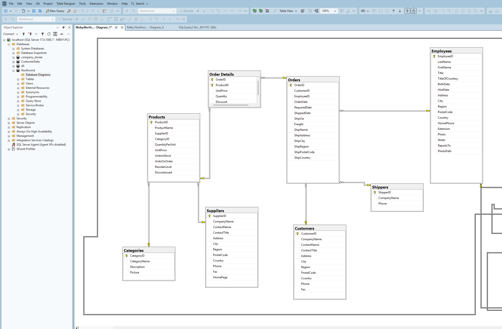
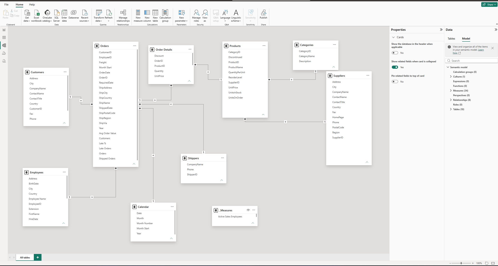

  

# Windfall - Northwind Sales Analysis

Sales analysis of the Northwind database using SQL Server for exploration and Power BI for the dashboard.

## Data

- Source: Northwind database (`instnwnd.sql`), SQL Server
- Period: July 1996 to 6 May 1998 (May 1998 is incomplete)
- Size: 830 orders, 2,155 order lines, 91 customers, 77 products
- Revenue = `UnitPrice * Quantity * (1 - Discount)`
- Late order = `ShippedDate > RequiredDate`

## SQL

File: `Northwind_Final_Queries.sql`

The script is split into 7 parts:

1. Data checks (row counts, date range, revenue validation against the built-in view)
2. Keys and joins (PKs, FKs, inner and left joins)
3. Overview (revenue, orders, average order value by year and month)
4. Revenue by category, product, country and customer
5. Customers (repeat customers)
6. Shipping (late orders by shipper and employee, days to ship, freight)
7. Inventory and discounts

  

## Power BI

File: `Northwind_Windfall_Data_mini.pbix`

Star-style model built on the Northwind tables with a Calendar table and a separate measures table (`_Measures`).

  

## Interactive Web Dashboard

An interactive dashboard built with vanilla HTML, modern CSS, and Chart.js is available in [`docs/`](../docs/).

- **Live Deployment**: Ready for instant hosting via GitHub Pages (source `/docs` folder) or Vercel (`vercel.json` provided).
- **Features**: Real-time KPI summaries, Revenue & monthly trends, Product & Category breakdowns, Customer & Geo distribution, Logistics & late shipping analysis, and Discount effectiveness analysis.

## Key Findings

- Total revenue: 1,265,793 across 830 orders from 89 customers, average order 1,525
- Beverages (21.2%) and Dairy Products (18.5%) are the top categories
- Top countries: USA (245,585), Germany (230,285), Austria (128,004)
- Top 10 customers make up about 45% of revenue
- 37 of 809 shipped orders were late; United Package has the highest late rate (5.1%)
- Average time to ship: 8.49 days
- Freight is about 5.1% of revenue
- Discounts total 88,665 (6.5% of sales before discount), and discounts above 5% do not increase quantity sold
- 21 orders are not shipped yet

Note: 1996 covers half a year and 1998 less than five months, so yearly totals are not directly comparable. A January-April comparison is included in the script.

## How to Run

1. **SQL Exploration**: Restore the Northwind database in SQL Server, then open and execute `Northwind_Final_Queries.sql`.
2. **Power BI Dashboard**: Open `Northwind_Windfall_Data_mini.pbix` in Power BI Desktop.
3. **Interactive Web Dashboard**: Open `docs/index.html` directly in any modern browser, or deploy the repository using GitHub Pages / Vercel.
